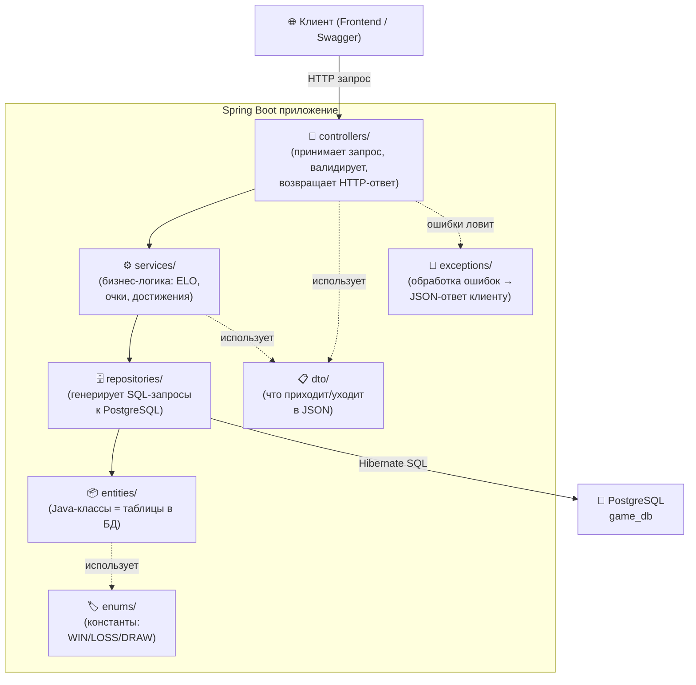
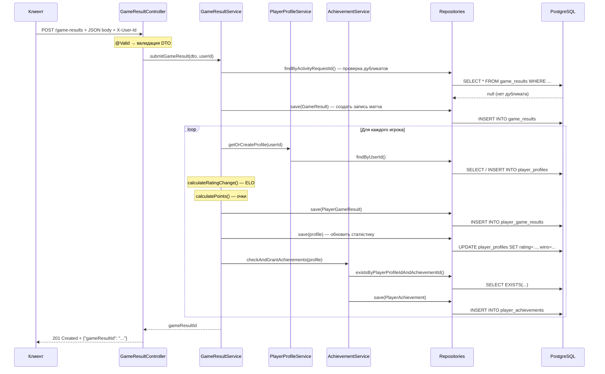

# Game Service — Полный разбор структуры проекта

## Общая картина

```
game-service/                         ← корень проекта
├── pom.xml                           ← конфигурация Maven (зависимости, плагины, версии)
├── Dockerfile                        ← инструкция для сборки Docker-образа
├── README.md                         ← описание проекта
├── .gitignore                        ← файлы, которые Git игнорирует
├── .git/                             ← репозиторий Git (история коммитов)
├── .idea/                            ← настройки IntelliJ IDEA (тема, кодировка, модули)
├── src/                              ← 📁 ИСХОДНЫЙ КОД (то, что ты пишешь руками)
│   ├── main/                         ← продуктовый код
│   │   ├── java/                     ← Java-классы
│   │   └── resources/                ← конфиги и SQL-миграции
│   └── test/                         ← тесты
│       └── java/                     ← тестовые Java-классы
└── target/                           ← 📁 РЕЗУЛЬТАТ СБОРКИ (генерируется Maven, НЕ коммитится)
    ├── classes/                       ← скомпилированные .class файлы + ресурсы
    ├── generated-sources/             ← код, сгенерированный annotation processors
    └── maven-status/                  ← метаданные компиляции
```

---

## 🏗️ Корневые файлы

### [pom.xml](file:///c:/Users/ser20/IdeaProjects/game-service/pom.xml)

**Что это**: Project Object Model — главный конфигурационный файл Maven. «Рецепт» для сборки проекта.

**Что внутри**:
- **`<parent>`** — наследуемся от `spring-boot-starter-parent:4.0.7`, который задаёт версии всех Spring-зависимостей
- **`<properties>`** — `java.version = 25`
- **`<dependencies>`** — список библиотек:

| Зависимость | Зачем |
|---|---|
| `spring-boot-starter-data-jpa` | ORM (Hibernate) + Spring Data JPA для работы с БД |
| `spring-boot-starter-flyway` | Автоматические миграции БД при запуске |
| `spring-boot-starter-validation` | Jakarta Validation (`@NotNull`, `@NotBlank` и т.д.) |
| `spring-boot-starter-webmvc` | REST-контроллеры, Jackson (JSON), встроенный Tomcat |
| `flyway-database-postgresql` | Драйвер Flyway для PostgreSQL |
| `postgresql` | JDBC-драйвер для подключения к PostgreSQL |
| `lombok` | Генерация getter/setter/builder через аннотации |
| `springdoc-openapi-starter-webmvc-ui` | Swagger UI для документации API |

- **`<build>`** — настройки плагинов: `spring-boot-maven-plugin` (упаковка JAR) и `maven-compiler-plugin` (Lombok annotation processor)

### [Dockerfile](file:///c:/Users/ser20/IdeaProjects/game-service/Dockerfile)

**Что это**: Инструкция для Docker — как собрать образ контейнера.

**Как работает** (multi-stage build):
```
Этап 1 (build): maven:3.9.13-eclipse-temurin-25
    → копирует исходники → mvn clean package → получает JAR

Этап 2 (runtime): eclipse-temurin:25-jre
    → копирует только JAR → запускает java -jar
```

Зачем два этапа? Финальный образ содержит только JRE + JAR (без Maven, без исходников), поэтому весит в разы меньше.

### [.gitignore](file:///c:/Users/ser20/IdeaProjects/game-service/.gitignore)

Исключает из Git:
- `target/` — результаты сборки (у каждого разработчика свои)
- `.idea/` — настройки IDE
- `*.iml`, `*.iws`, `*.ipr` — файлы модулей IntelliJ

---

## 📁 `src/main/java` — Исходный код

Базовый пакет: `team.anonyms.athletelink.gameservice`

### Архитектура (слоёная)



### Поток обработки запроса (пример: `POST /game-results`)



---

### 📡 `controllers/` — Входная точка API

**Роль**: Принимает HTTP-запросы, делегирует работу сервисам, формирует HTTP-ответы.

| Файл | Маппинг | Эндпоинты |
|---|---|---|
| [GameResultController.java](file:///c:/Users/ser20/IdeaProjects/game-service/src/main/java/team/anonyms/athletelink/gameservice/controllers/GameResultController.java) | `/game-results` | `POST /` — отправить результат, `GET /{id}` — детали |
| [PlayerProfileController.java](file:///c:/Users/ser20/IdeaProjects/game-service/src/main/java/team/anonyms/athletelink/gameservice/controllers/PlayerProfileController.java) | (несколько путей) | `GET /profiles/{userId}`, `/history`, `/achievements`, `/leaderboard` |
| [AchievementController.java](file:///c:/Users/ser20/IdeaProjects/game-service/src/main/java/team/anonyms/athletelink/gameservice/controllers/AchievementController.java) | `/achievements` | `GET /` — каталог достижений |

**Ключевые паттерны**:
- `@RestController` — помечает класс как REST-контроллер (ответы в JSON)
- `@RequestMapping("/game-results")` — базовый URL для всех методов класса
- `@RequestBody @Valid SubmitGameResultDto dto` — Spring десериализует JSON → record + валидирует
- `@RequestHeader("X-User-Id") UUID userId` — берёт ID пользователя из заголовка (придёт от API Gateway)
- `ResponseEntity.status(HttpStatus.CREATED)` — явное управление HTTP-статусом
- `Logger` — логирование каждого запроса через SLF4J
- `@Tag`, `@Operation`, `@ApiResponses` — Swagger-аннотации для документации

---

### ⚙️ `services/` — Бизнес-логика

**Роль**: Вся логика приложения. Контроллеры «тупые» — они только вызывают сервисы.

| Файл | Ответственность |
|---|---|
| [GameResultService.java](file:///c:/Users/ser20/IdeaProjects/game-service/src/main/java/team/anonyms/athletelink/gameservice/services/GameResultService.java) | Приём результатов, расчёт ELO, начисление очков, обновление статистики, история матчей |
| [PlayerProfileService.java](file:///c:/Users/ser20/IdeaProjects/game-service/src/main/java/team/anonyms/athletelink/gameservice/services/PlayerProfileService.java) | Профили игроков (получение, авто-создание), лидерборд |
| [AchievementService.java](file:///c:/Users/ser20/IdeaProjects/game-service/src/main/java/team/anonyms/athletelink/gameservice/services/AchievementService.java) | Каталог достижений, проверка условий, выдача игрокам |

**Ключевые паттерны**:
- `@Service` — Spring создаёт singleton-бин и внедряет зависимости
- `@Transactional` — оборачивает метод в DB-транзакцию (если что-то упадёт — все изменения откатятся)
- `IllegalArgumentException` — бизнес-ошибки (ловятся в `GlobalExceptionHandler` → возвращают 400)
- Constructor injection — зависимости через конструктор (без `@Autowired`)

---

### 🗄️ `repositories/` — Доступ к данным

**Роль**: Интерфейсы, которые Spring Data JPA **автоматически реализует** на основе имён методов.

| Файл | Entity | Ключевые методы |
|---|---|---|
| [PlayerProfileRepository.java](file:///c:/Users/ser20/IdeaProjects/game-service/src/main/java/team/anonyms/athletelink/gameservice/repositories/PlayerProfileRepository.java) | PlayerProfile | `findByUserId()`, `findTop50ByOrderByRatingDesc()` |
| [GameResultRepository.java](file:///c:/Users/ser20/IdeaProjects/game-service/src/main/java/team/anonyms/athletelink/gameservice/repositories/GameResultRepository.java) | GameResult | `findByActivityRequestId()` |
| [PlayerGameResultRepository.java](file:///c:/Users/ser20/IdeaProjects/game-service/src/main/java/team/anonyms/athletelink/gameservice/repositories/PlayerGameResultRepository.java) | PlayerGameResult | `findAllByGameResultId()`, `findAllByPlayerProfileIdOrderByGameResult_PlayedAtDesc()` |
| [AchievementRepository.java](file:///c:/Users/ser20/IdeaProjects/game-service/src/main/java/team/anonyms/athletelink/gameservice/repositories/AchievementRepository.java) | Achievement | `findByCode()` |
| [PlayerAchievementRepository.java](file:///c:/Users/ser20/IdeaProjects/game-service/src/main/java/team/anonyms/athletelink/gameservice/repositories/PlayerAchievementRepository.java) | PlayerAchievement | `findAllByPlayerProfileId()`, `existsByPlayerProfileIdAndAchievementId()` |

**Как это работает**: Ты пишешь только интерфейс `extends JpaRepository<Entity, IdType>`. Spring Data анализирует имя метода (например `findByUserId`) и **автоматически генерирует SQL**:
```sql
SELECT * FROM player_profiles WHERE user_id = ?
```

Метод `findTop50ByOrderByRatingDesc()` транслируется в:
```sql
SELECT * FROM player_profiles ORDER BY rating DESC LIMIT 50
```

Ты **не пишешь ни строчки SQL** — всё генерируется из имени метода.

---

### 📦 `entities/` — JPA-сущности

**Роль**: Каждый класс = одна таблица в PostgreSQL. Hibernate (ORM) маппит поля класса на колонки таблицы.

| Файл | Таблица | PK | Описание |
|---|---|---|---|
| [PlayerProfile.java](file:///c:/Users/ser20/IdeaProjects/game-service/src/main/java/team/anonyms/athletelink/gameservice/entities/PlayerProfile.java) | `player_profiles` | UUID | Агрегированная статистика игрока (рейтинг, очки, W/L/D) |
| [GameResult.java](file:///c:/Users/ser20/IdeaProjects/game-service/src/main/java/team/anonyms/athletelink/gameservice/entities/GameResult.java) | `game_results` | UUID | Результат конкретного матча |
| [PlayerGameResult.java](file:///c:/Users/ser20/IdeaProjects/game-service/src/main/java/team/anonyms/athletelink/gameservice/entities/PlayerGameResult.java) | `player_game_results` | UUID | Индивидуальный результат игрока в матче |
| [Achievement.java](file:///c:/Users/ser20/IdeaProjects/game-service/src/main/java/team/anonyms/athletelink/gameservice/entities/Achievement.java) | `achievements` | Long (BIGSERIAL) | Справочник достижений |
| [PlayerAchievement.java](file:///c:/Users/ser20/IdeaProjects/game-service/src/main/java/team/anonyms/athletelink/gameservice/entities/PlayerAchievement.java) | `player_achievements` | UUID | Связь «игрок получил достижение» |

**Ключевые аннотации**:
- `@Entity` + `@Table(name = "...")` — связывает класс с таблицей
- `@Id` + `@GeneratedValue` — первичный ключ (генерируется автоматически)
- `@ManyToOne(fetch = FetchType.LAZY)` — связь с другой таблицей (загружается только при обращении)
- `@Enumerated(EnumType.STRING)` + `@JdbcTypeCode(SqlTypes.NAMED_ENUM)` — enum как PostgreSQL enum
- `@CreationTimestamp` — автоматически ставит текущее время при создании записи
- `@Builder.Default` — значение по умолчанию для Builder-паттерна (`rating = 1000`, `wins = 0`)

---

### 📋 `dto/` — Data Transfer Objects

**Роль**: Объекты для передачи данных между клиентом и сервером. **Не привязаны к БД** — определяют что видит клиент в JSON.

| Файл | Направление | Описание |
|---|---|---|
| [SubmitGameResultDto.java](file:///c:/Users/ser20/IdeaProjects/game-service/src/main/java/team/anonyms/athletelink/gameservice/dto/SubmitGameResultDto.java) | → вход | JSON-тело для `POST /game-results` (содержит вложенный `PlayerResultEntry`) |
| [GameResultDetailsDto.java](file:///c:/Users/ser20/IdeaProjects/game-service/src/main/java/team/anonyms/athletelink/gameservice/dto/GameResultDetailsDto.java) | ← выход | Ответ `GET /game-results/{id}` (содержит вложенный `PlayerResultDto`) |
| [PlayerProfileDto.java](file:///c:/Users/ser20/IdeaProjects/game-service/src/main/java/team/anonyms/athletelink/gameservice/dto/PlayerProfileDto.java) | ← выход | Ответ `GET /profiles/{userId}` |
| [PlayerGameHistoryDto.java](file:///c:/Users/ser20/IdeaProjects/game-service/src/main/java/team/anonyms/athletelink/gameservice/dto/PlayerGameHistoryDto.java) | ← выход | Элемент массива `GET /profiles/{userId}/history` |
| [AchievementDto.java](file:///c:/Users/ser20/IdeaProjects/game-service/src/main/java/team/anonyms/athletelink/gameservice/dto/AchievementDto.java) | ← выход | Элемент массива `GET /achievements` |
| [PlayerAchievementDto.java](file:///c:/Users/ser20/IdeaProjects/game-service/src/main/java/team/anonyms/athletelink/gameservice/dto/PlayerAchievementDto.java) | ← выход | Элемент массива `GET /profiles/{userId}/achievements` |
| [LeaderboardEntryDto.java](file:///c:/Users/ser20/IdeaProjects/game-service/src/main/java/team/anonyms/athletelink/gameservice/dto/LeaderboardEntryDto.java) | ← выход | Элемент массива `GET /leaderboard` |

**Почему `record`, а не `class`?** Java `record` — это иммутабельный класс с автоматическими `equals()`, `hashCode()`, `toString()` и геттерами. Идеален для DTO, где данные только передаются, но не изменяются.

**Почему DTO, а не Entity напрямую?**
1. Entity содержит внутренние поля (JPA-связи, `id` профиля), которые клиенту не нужны
2. Entity может выдать лишнее (пароли, внутренние статусы)
3. Формат API может меняться независимо от схемы БД

---

### 🏷️ `enums/` — Перечисления

| Файл | Значения | Где используется |
|---|---|---|
| [GameResultStatus.java](file:///c:/Users/ser20/IdeaProjects/game-service/src/main/java/team/anonyms/athletelink/gameservice/enums/GameResultStatus.java) | `PENDING`, `CONFIRMED`, `DISPUTED` | `GameResult.status` |
| [GameOutcome.java](file:///c:/Users/ser20/IdeaProjects/game-service/src/main/java/team/anonyms/athletelink/gameservice/enums/GameOutcome.java) | `WIN`, `LOSS`, `DRAW` | `PlayerGameResult.outcome` |

В PostgreSQL хранятся как `CREATE TYPE ... AS ENUM (...)` — база данных сама проверяет допустимые значения.

---

### 🚨 `exceptions/` — Обработка ошибок

| Файл | Описание |
|---|---|
| [GlobalExceptionHandler.java](file:///c:/Users/ser20/IdeaProjects/game-service/src/main/java/team/anonyms/athletelink/gameservice/exceptions/GlobalExceptionHandler.java) | Перехватывает все исключения и превращает их в JSON-ответы |

Обрабатывает два типа ошибок:

| Исключение | HTTP-код | Пример ответа |
|---|---|---|
| `IllegalArgumentException` | 400 | `{"error": "Bad Request", "message": "Game result not found"}` |
| `MethodArgumentNotValidException` | 400 | `{"sportId": "Sport ID is required", "playedAt": "..."}` |

---

## 📁 `src/main/resources/` — Ресурсы

| Файл/папка | Роль |
|---|---|
| [application.yaml](file:///c:/Users/ser20/IdeaProjects/game-service/src/main/resources/application.yaml) | Конфигурация приложения (подключение к БД, порт, логирование) |
| [db/migration/V1__init_game_schema.sql](file:///c:/Users/ser20/IdeaProjects/game-service/src/main/resources/db/migration/V1__init_game_schema.sql) | Flyway-миграция: создаёт все таблицы и заполняет достижения |

**Flyway** работает так: при запуске приложения он смотрит в папку `db/migration/`, находит файлы вида `V1__..., V2__...` и выполняет их последовательно. Если `V1` уже была применена — пропускает. Это гарантирует, что схема БД всегда актуальна на любом окружении.

---

## 📁 `src/test/` — Тесты

| Файл | Описание |
|---|---|
| [MainTests.java](file:///c:/Users/ser20/IdeaProjects/game-service/src/test/java/team/anonyms/athletelink/gameservice/MainTests.java) | Smoke-тест: проверяет, что Spring-контекст стартует без ошибок |

---

## 📁 `target/` — Результат сборки

> [!NOTE]
> Эта папка **генерируется Maven** при `mvn compile` / `mvn package`. Не коммитится в Git (указана в `.gitignore`). Можно безопасно удалить — Maven пересоздаст.

```
target/
├── classes/                           ← скомпилированный код
│   ├── application.yaml               ← копия из src/main/resources
│   ├── db/migration/
│   │   └── V1__init_game_schema.sql   ← копия миграции
│   └── team/anonyms/athletelink/gameservice/
│       ├── Main.class                 ← скомпилированный Main.java
│       ├── controllers/               ← .class файлы контроллеров
│       ├── services/                  ← .class файлы сервисов
│       ├── repositories/              ← .class файлы репозиториев
│       ├── entities/                  ← .class файлы сущностей
│       ├── dto/                       ← .class файлы DTO
│       ├── enums/                     ← .class файлы enum'ов
│       └── exceptions/                ← .class файлы обработчика ошибок
├── generated-sources/
│   └── annotations/                   ← код от Lombok annotation processor
└── maven-status/
    └── maven-compiler-plugin/         ← логи компиляции (какие файлы скомпилированы)
```

**`.java` → `.class`**: Java-компилятор (`javac`) преобразует исходники в байт-код JVM. Именно `.class` файлы выполняются на `java -jar`.

**Что делает `mvn package`** (используется в Dockerfile):
1. `compile` — компилирует `.java` → `.class` в `target/classes/`
2. `test` — запускает тесты
3. `package` — упаковывает всё в `target/game-service.jar` (исполняемый JAR со встроенным Tomcat)

---

## Резюме: связь между слоями

```
Клиент → Controller → Service → Repository → Entity → PostgreSQL
            ↕              ↕
           DTO            Enum
            ↑
      ExceptionHandler (перехватывает ошибки)
```

Каждый слой знает только о соседнем:
- **Controller** знает о **Service** и **DTO**
- **Service** знает о **Repository**, **Entity** и **DTO**
- **Repository** знает только о **Entity**
- **Entity** знает только о **Enum**
- **DTO** и **Enum** ни от кого не зависят
